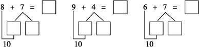

# Mathematics (Grade 4)

**ID**: 6c354af3
**难度**: medium_easy
**题型**: fill_in_the_blank

## 题目

## 解答

**答案**: 2, 5, 15, 1, 3, 13, 4, 3, 13

1. Step1:计算8 + 7，将7拆分为2和5，8 + 2 = 10，10 + 5 = 15，得到第一个结果15和拆分的2、5
2. Step2:计算9 + 4，将4拆分为1和3，9 + 1 = 10，10 + 3 = 13，得到第二个结果13和拆分的1、3
3. Step3:计算6 + 7，将7拆分为4和3，6 + 4 = 10，10 + 3 = 13，得到第三个结果13和拆分的4、3
4. Step4:将拆分的数字和计算结果按顺序整理为['2', '5', '15', '1', '3', '13', '4', '3', '13']

## 知识点

**知识点**:
  - 小学数学;数与代数;数的运算;整数的四则运算

---
