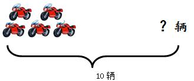

# Mathematics (Grade 4)

**ID**: 7818a5ba
**难度**: medium_easy
**题型**: fill_in_the_blank

## 题目
看图填一填

□○□=□

## 解答

**答案**: 10, 5, 5

1. Step1:观察图片可知，图中摩托车总数是10辆，左边有5辆
2. Step2:问题是求右边摩托车的数量
3. Step3:根据总数和左边数量求右边数量，用总数10减去左边的5辆
4. Step4:计算10 - 5的结果为5
5. Step5:得出答案依次为总数10、左边数量5、右边数量5

## 知识点

**知识点**:
  - 小学数学;数与代数;数的运算;整数的四则运算;整数的加法、减法;应用题;常见的数学问题;图文问题

---
