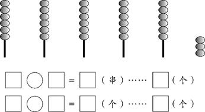

# Mathematics (Grade 4)

**ID**: 7a0c69d8
**难度**: medium_easy
**题型**: fill_in_the_blank

## 题目
看图写出两道除法算式．

## 解答

**答案**: 33÷6=5（串）……3（个）, 33÷5=6（个）……3（个）

1. Step1:观察图片可知，图中一共有33个物品，每6个为一串，可据此列出除法算式33÷6，商为串数，余数为剩余个数，即33÷6=5（串）……3（个）
2. Step2:又因为物品总共33个，分成了5串，可据此列出除法算式33÷5，商为每串个数，余数为剩余个数，即33÷5=6（个）……3（个）

## 知识点

**知识点**:
  - 小学数学;数与代数;数的运算;整数的四则运算;有余数的除法;应用题;常见的数学问题;图文问题

---
