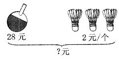

# Mathematics (Grade 4)

**ID**: 83df68e9
**难度**: medium_easy
**题型**: fill_in_the_blank

## 题目
看图并列式计算。

算式__________

## 解答

**答案**: 28＋2×3＝34（元）

1. Step1:观察图片可知，乒乓球拍价格是28元，羽毛球每个2元，有3个羽毛球
2. Step2:根据总价=单价×数量，可先计算出3个羽毛球的总价为2×3元
3. Step3:要求乒乓球拍和3个羽毛球的总价，需将乒乓球拍的价格28元与3个羽毛球的总价相加，即列出算式28＋2×3
4. Step4:计算28＋2×3，先算乘法2×3=6，再算加法28+6=34，得到总价为34元，所以完整算式为28＋2×3＝34（元）

## 知识点

**知识点**:
  - 小学数学;数与代数;数的运算;整数的四则运算;整数四则混合运算

---
