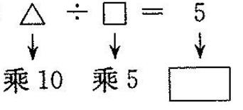

# Mathematics (Grade 4)

**ID**: 86acf385
**难度**: medium_easy
**题型**: fill_in_the_blank

## 题目

 △÷□=5  乘10  乘5

## 解答

**答案**: 2

1. Step1:根据解析2可知，当被除数乘以10，除数乘以5时，商的变化为被除数变化倍数除以除数变化倍数
2. Step2:这里被除数变化倍数为10，除数变化倍数为5
3. Step3:所以商应乘以10÷5
4. Step4:计算10÷5=2，即变化后的商是原来商的2倍

## 知识点

**知识点**:
  - 除数是两位数的除法;笔算除法;商的变化规律

---
