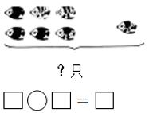

# Mathematics (Grade 4)

**ID**: 8d6706cd
**难度**: medium_easy
**题型**: fill_in_the_blank

## 题目
看图列算式：

## 解答

**答案**: 6+1=7

1. Step1:观察图片，左边有6条鱼，右边有1条鱼
2. Step2:求鱼的总数，用左边鱼的数量加上右边鱼的数量
3. Step3:左边鱼的数量是6，右边鱼的数量是1，所以列出算式6+1=7

## 知识点

**知识点**:
  - 小学数学;数与代数;数的运算;整数的四则运算;整数的加法、减法;应用题;常见的数学问题;图文问题

---
