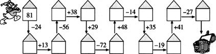

# Mathematics (Grade 4)

**ID**: 941a4471
**难度**: medium_easy
**题型**: fill_in_the_blank

## 题目
寻宝。(算一算)

## 解答

**答案**: 57, 70, 14, 52, 81, 9, 57, 43, 78, 59, 100, 73

1. Step1:从左到右，第一个数81减去24得到57
2. Step2:57加上13得到70
3. Step3:70减去56得到14
4. Step4:14加上38得到52
5. Step5:52加上29得到81
6. Step6:81减去72得到9
7. Step7:9加上48得到57
8. Step8:57减去19得到43
9. Step9:43加上35得到78
10. Step10:78减去19得到59
11. Step11:59加上41得到100
12. Step12:100减去27得到73

## 知识点

**知识点**:
  - 小学数学;数与代数;数的运算;整数的四则运算

---
