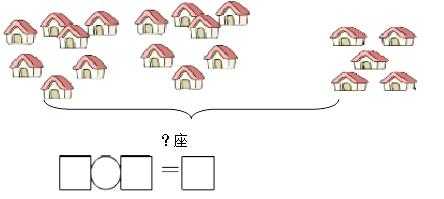

# Mathematics (Grade 4)

**ID**: baf27930
**难度**: medium_easy
**题型**: fill_in_the_blank

## 题目
看图写算式。

## 解答

**答案**: 14+5=19

1. Step1:观察图片，数出左边房子的数量为14座
2. Step2:数出右边房子的数量为5座
3. Step3:根据加法的意义，将左右两边房子的数量相加，即14 + 5
4. Step4:得出总数为19座，所以列出算式14 + 5 = 19

## 知识点

**知识点**:
  - 小学数学;数与代数;数的运算;整数的四则运算;整数的加法、减法

---
