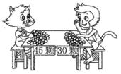

# Mathematics (Grade 4)

**ID**: bb61becc
**难度**: medium_easy
**题型**: fill_in_the_blank

## 题目
小猫和小猴一共折了多少颗星星？

## 解答

**答案**: 75

1. Step1:已知小猫折了45颗星星，小猴折了30颗星星
2. Step2:要求小猫和小猴一共折的星星数，需将两者折的星星数相加
3. Step3:进行计算45 + 30 = 75颗

## 知识点

**知识点**:
  - 小学数学;数与代数;数的运算;整数的四则运算

---
