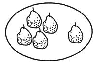

# Mathematics (Grade 4)

**ID**: c0d3d210
**难度**: medium_easy
**题型**: fill_in_the_blank

## 题目
看图计算 

（1）4＋1=
（2）1＋4=

## 解答

**答案**: 5, 5

1. Step1:观察图片，可知左边有4个梨，右边有1个梨
2. Step2:计算4＋1，根据加法运算，4个梨和1个梨合起来是5个梨，所以4＋1=5
3. Step3:计算1＋4，加法满足交换律，1个梨和4个梨合起来同样是5个梨，所以1＋4=5

## 知识点

**知识点**:
  - 小学数学;数与代数;数的运算;整数的四则运算;整数的加法、减法

---
