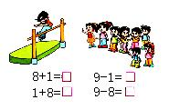

# Mathematics (Grade 4)

**ID**: c79f8ae0
**难度**: medium_easy
**题型**: fill_in_the_blank

## 题目
看图列式计算。

## 解答

**答案**: 8+1=9, 9-1=8, 1+8=9, 9-8=1

1. Step1:根据图片中左侧有8个物体和右侧有1个物体，可得加法算式8 + 1 = 9
2. Step2:交换加数位置，可得加法算式1 + 8 = 9
3. Step3:由8 + 1 = 9，可得减法算式9 - 1 = 8
4. Step4:由8 + 1 = 9，可得减法算式9 - 8 = 1

## 知识点

**知识点**:
  - 小学数学;数与代数;数的运算;整数的四则运算

---
