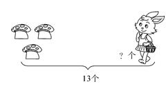

# Mathematics (Grade 4)

**ID**: ca7ad0bf
**难度**: medium_easy
**题型**: fill_in_the_blank

## 题目
看图列式计算。

□○□=□（个）

## 解答

**答案**: 13, ―, 3, =, 10

1. Step1:观察图片可知，一共有13个蘑菇，左边有3个蘑菇
2. Step2:问题是求右边篮子里蘑菇的数量
3. Step3:根据减法的意义，用蘑菇的总数减去左边蘑菇的数量，就可得到右边篮子里蘑菇的数量
4. Step4:总数是13，左边数量是3，所以列式为13 - 3
5. Step5:计算13 - 3的结果为10

## 知识点

**知识点**:
  - 小学数学;数与代数;数的运算;整数的四则运算;整数的加法、减法;应用题;常见的数学问题;图文问题

---
