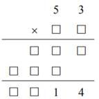

# Mathematics (Grade 4)

**ID**: d233d655
**难度**: medium_easy
**题型**: fill_in_the_blank

## 题目
下图竖式中的乘积是_________．

## 解答

**答案**: 2014

1. Step1:观察竖式，积的末尾数字是4，因为3乘8得24，所以第二个因数的个位可能是8。
2. Step2:53乘8等于424，而积的十位是1，说明第二个因数十位与53相乘的积的末位是9（因为4+9=13，向十位进1后得到积的十位是1），又因为3乘3得9，所以第二个因数的十位是3。
3. Step3:计算53乘38，53×38 = 53×(30 + 8)=53×30 + 53×8 = 1590 + 424 = 2014，所以乘积是2014。

## 知识点

**知识点**:
  - 小学数学;数与代数;数的运算;整数的四则运算;整数乘法

---
