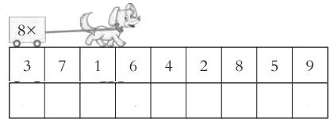

# Mathematics (Grade 4)

**ID**: de9cbb47
**难度**: medium_easy
**题型**: fill_in_the_blank

## 题目
小狗拉车．（口算）

## 解答

**答案**: 24, 56, 8, 48, 32, 16, 64, 40, 72

1. Step1:计算8×3=24
2. Step2:计算8×7=56
3. Step3:计算8×1=8
4. Step4:计算8×6=48
5. Step5:计算8×4=32
6. Step6:计算8×2=16
7. Step7:计算8×8=64
8. Step8:计算8×5=40
9. Step9:计算8×9=72

## 知识点

**知识点**:
  - 小学数学;数与代数;数的运算;整数的四则运算;表内乘法

---
