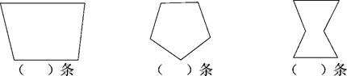

# Mathematics (Grade 4)

**ID**: e29080d4
**难度**: medium_easy
**题型**: fill_in_the_blank

## 题目
我会数。(下面的图形各由几条线段组成)

## 解答

**答案**: 4, 5, 6

1. Step1:观察第一个图形，它是一个梯形，梯形由4条线段组成
2. Step2:观察第二个图形，它是一个五边形，五边形由5条线段组成
3. Step3:观察第三个图形，它由6条线段组成

## 知识点

**知识点**:
  - 

---
