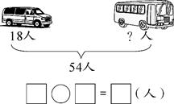

# Mathematics (Grade 4)

**ID**: e541547d
**难度**: medium_easy
**题型**: fill_in_the_blank

## 题目

## 解答

**答案**: 36

1. Step1:已知总人数是54人，其中一辆车坐了18人，要求另一辆车的人数。
2. Step2:用总人数54减去已知车上的18人，即54 - 18。
3. Step3:计算54 - 18的结果为36，所以另一辆车的人数是36人。

## 知识点

**知识点**:
  - 小学数学;数与代数;数的运算;整数的四则运算;整数的加法、减法

---
