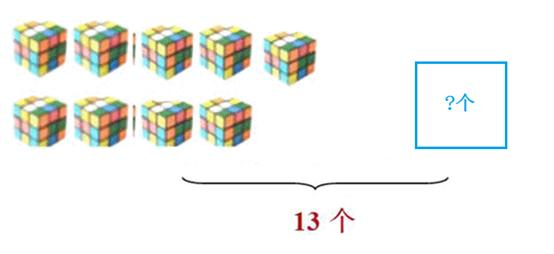

# Mathematics (Grade 4)

**ID**: 3dd583f8
**难度**: medium_easy
**题型**: multiple_choice

## 题目
看一看，算一算。

□○□＝□（个）

## 解答

**答案**: 4

1. Step1:观察图片可知，魔方的总数是13个，其中已知的魔方有9个
2. Step2:要求的是未知的魔方个数
3. Step3:根据减法的意义，用总数减去已知的个数就能得到未知的个数，即13 - 9
4. Step4:计算13 - 9的结果为4

## 知识点

**知识点**:
  - 小学数学;数与代数;数的运算;整数的四则运算;应用题;常见的数学问题;图文问题

---
