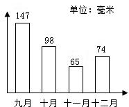

# Mathematics (Grade 4)

**ID**: 9e24ddd2
**难度**: medium_easy
**题型**: multiple_choice

## 题目
某地去年最后四个月的降水量如图，这个地方在这四个月里每月平均降水量（  ）毫米．
A．147
B．98
C．96
D．86

## 解答

**答案**: C

1. Step1:根据统计图可知，九月降水量为147毫米，十月降水量为98毫米，十一月降水量为65毫米，十二月降水量为74毫米
2. Step2:计算四个月降水量的总量，即147 + 98 + 65 + 74 = 384毫米
3. Step3:确定总份数为4，因为是求四个月的平均降水量
4. Step4:根据求平均数的方法，用总量除以总份数，即384÷4 = 96毫米
5. Step5:得出这四个月里每月平均降水量是96毫米，所以答案选C

## 知识点

**知识点**:
  - 两种不同形式的单式条形统计图；平均数的含义及求平均数的方法．

---
