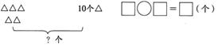

# Mathematics (Grade 4)

**ID**: 017413d0
**难度**: medium_easy
**题型**: short_answer

## 题目
看图列式计算。

## 解答

**答案**: 15

1. Step1:观察图片可知，左边有5个△，右边有10个△
2. Step2:要求一共有多少个△，需将左右两边的△数量相加
3. Step3:即计算5 + 10的结果，5 + 10 = 15

## 知识点

**知识点**:
  - 小学数学;数与代数;数的运算;整数的四则运算;整数的加法、减法;应用题;常见的数学问题;图文问题

---
