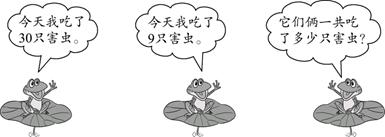

# Mathematics (Grade 4)

**ID**: 176d2c43
**难度**: medium_easy
**题型**: short_answer

## 题目

## 解答

**答案**: 39

1. Step1:明确题目是求两只青蛙吃害虫数量的总和
2. Step2:已知一只青蛙吃了30只害虫，另一只吃了9只害虫
3. Step3:将两只青蛙吃害虫的数量相加，即30 + 9
4. Step4:计算得出30 + 9 = 39只

## 知识点

**知识点**:
  - 小学数学;数与代数;数的运算;整数的四则运算

---
