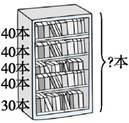

# Mathematics (Grade 4)

**ID**: 246f6b03
**难度**: medium_easy
**题型**: short_answer

## 题目
看图列式计算。

## 解答

**答案**: 190本

1. Step1:分析图可知，有4层每层40本，还有一层30本
2. Step2:先计算4层每层40本的总数，用乘法40×4
3. Step3:再将4层的总数加上单独一层的30本，即40×4 + 30
4. Step4:计算40×4 + 30的结果为190本

## 知识点

**知识点**:
  - 小学数学;数与代数;数的运算;整数的四则运算;整数乘法;应用题;常见的数学问题;图文问题

---
