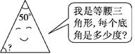

# Mathematics (Grade 4)

**ID**: 500b52d4
**难度**: medium_easy
**题型**: short_answer

## 题目

## 解答

**答案**: 65°

1. Step1:因为三角形内角和是180°，且这是等腰三角形，两个底角相等
2. Step2:已知顶角是50°，所以用180°减去顶角50°，得到两个底角的度数和为180° - 50°
3. Step3:再将两个底角的度数和除以2，即(180° - 50°)÷2，求出每个底角的度数为65°

## 知识点

**知识点**:
  - 小学数学;图形与几何;平面图形;三角形;等腰三角形和等边三角形的认识及特征;三角形的内角和

---
