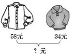

# Mathematics (Grade 4)

**ID**: 5b935017
**难度**: medium_easy
**题型**: short_answer

## 题目
看图列式计算。

## 解答

**答案**: 92元

1. Step1:观察图片可知，一件衣服价格是58元，另一件衣服价格是34元
2. Step2:求两件衣服总共的价格，需将两件衣服的价格相加，即58 + 34
3. Step3:计算58 + 34的结果为92元

## 知识点

**知识点**:
  - 小学数学;数与代数;数的运算;整数的四则运算;整数的加法、减法

---
