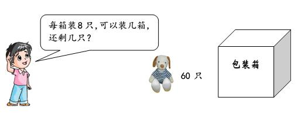

# Mathematics (Grade 4)

**ID**: 5f8200dc
**难度**: medium_easy
**题型**: short_answer

## 题目

## 解答

**答案**: 7箱, 4只

1. Step1:用玩具总数60只除以每箱装的8只，即60÷8
2. Step2:计算60÷8的商，商就是可以装的箱数，得到7箱
3. Step3:计算60÷8的余数，余数就是剩余的只数，得到4只

## 知识点

**知识点**:
  - 小学数学;数与代数;数的运算;整数的四则运算;有余数的除法

---
