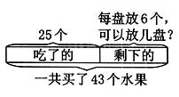

# Mathematics (Grade 4)

**ID**: 661c3d27
**难度**: medium_easy
**题型**: short_answer

## 题目
看图列式计算。

## 解答

**答案**: 3

1. Step1:先求出剩下水果的数量，用总共买的水果数43个减去吃了的25个，即43 - 25 = 18个
2. Step2:再用剩下水果的数量18个除以每盘放的6个，得到可放的盘数，即18÷6 = 3盘

## 知识点

**知识点**:
  - 小学数学;数与代数;数的运算;整数的四则运算;整数四则混合运算

---
