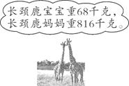

# Mathematics (Grade 4)

**ID**: 827e845b
**难度**: medium_easy
**题型**: short_answer

## 题目
(1)长颈鹿妈妈的体重是长颈鹿宝宝体重的几倍？

(2)玲玲的体重是24千克，长颈鹿妈妈的体重是玲玲体重的几倍？

## 解答

**答案**: 12倍, 34倍

1. Step1:求长颈鹿妈妈体重是长颈鹿宝宝体重的几倍，用长颈鹿妈妈的体重816千克除以长颈鹿宝宝的体重68千克，即816÷68 = 12，得出答案为12倍
2. Step2:求长颈鹿妈妈体重是玲玲体重的几倍，用长颈鹿妈妈的体重816千克除以玲玲的体重24千克，即816÷24 = 34，得出答案为34倍

## 知识点

**知识点**:
  - 小学数学;数与代数;数的运算;整数的四则运算;整数除法

---
