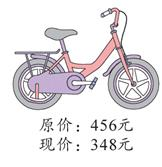

# Mathematics (Grade 4)

**ID**: 8fd91a3b
**难度**: medium_easy
**题型**: short_answer

## 题目
现在买这辆自行车大约优惠多少钱？

## 解答

**答案**: 110元

1. Step1:明确问题是求自行车优惠的金额，即原价与现价的差值
2. Step2:已知自行车原价456元，现价348元
3. Step3:计算456 - 348 = 108元
4. Step4:题目问大约优惠多少钱，108元接近110元，所以答案是110元

## 知识点

**知识点**:
  - 小学数学;数与代数;数的运算;整数的四则运算;整数的加法、减法

---
