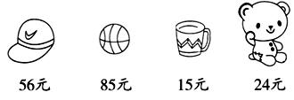

# Mathematics (Grade 4)

**ID**: 9b182510
**难度**: medium_easy
**题型**: short_answer

## 题目
小明购买了下面四种商品各一件，算一算，他共花了多少钱？

## 解答

**答案**: 180元

1. Step1:明确要计算四种商品的总价，列出算式56＋85＋15＋24
2. Step2:利用加法交换律和结合律对算式进行变形，得到（56＋24）＋（85＋15）
3. Step3:先计算括号内的加法，56＋24 = 80，85＋15 = 100
4. Step4:再计算80 + 100 = 180，得出总价为180元

## 知识点

**知识点**:
  - 小学数学;数与代数;数的运算;整数的四则运算;整数的运算律与简便计算;应用题;简单应用题;整数简单应用题

---
