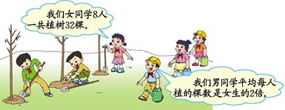

# Mathematics (Grade 4)

**ID**: af023b9e
**难度**: medium_easy
**题型**: short_answer

## 题目

(1)女同学平均每人植树多少棵? 
(2)男同学平均每人植树多少棵?

## 解答

**答案**: 4, 8

1. Step1:求女同学平均每人植树的棵数，用女同学植树的总棵数32棵除以女同学的人数8人，即32÷8 = 4棵
2. Step2:已知男同学平均每人植的棵数是女生的2倍，用女同学平均每人植树的棵数4棵乘2，即4×2 = 8棵

## 知识点

**知识点**:
  - 小学数学;数与代数;数的运算;整数的四则运算;表内除法;应用题;简单应用题;整数简单应用题

---
