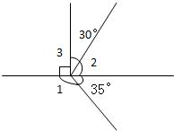

# Mathematics (Grade 4)

**ID**: c91b27fc
**难度**: medium_easy
**题型**: short_answer

## 题目
如图：

求：∠1、∠2、∠3的度数．

## 解答

**答案**: 145°, 90°, 60°

1. Step1:因为平角为180°，与35°角组成平角的是∠1，所以∠1=180° - 35° = 145°
2. Step2:由图可知∠3是直角，根据直角定义，直角为90°，所以∠3 = 90°
3. Step3:因为∠2与30°角组成直角，直角是90°，所以∠2 = 90° - 30° = 60°

## 知识点

**知识点**:
  - 角的度量．

---
