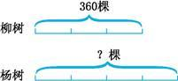

# Mathematics (Grade 4)

**ID**: e13c2f47
**难度**: medium_easy
**题型**: short_answer

## 题目
看图列式计算

## 解答

**答案**: 480

1. Step1:由图可知柳树有360棵，且柳树被平均分成3份
2. Step2:可先求出每份的棵数，即360÷3
3. Step3:杨树的份数是4份
4. Step4:再用每份的棵数乘杨树的份数，即360÷3×4，计算得出480棵

## 知识点

**知识点**:
  - 小学数学;数与代数;数的运算;整数的四则运算;整数四则混合运算;应用题;常见的数学问题;图文问题

---
