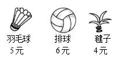

# Mathematics (Grade 4)

**ID**: f2756eb6
**难度**: medium_easy
**题型**: short_answer

## 题目

（1）20元可以买多少个羽毛球？
（2）你还能提出一个用除法计算的问题吗？并解答。

## 解答

**答案**: 4, 5个

1. Step1:已知羽毛球单价为5元，求20元可以买多少个羽毛球，根据数量 = 总价÷单价，可得20÷5 = 4个
2. Step2:提出用除法计算的问题：30元可以买多少个排球，已知排球单价为6元，同样根据数量 = 总价÷单价，可得30÷6 = 5个

## 知识点

**知识点**:
  - 小学数学;数与代数;数的运算;整数的四则运算;表内除法;应用题;常见的数学问题;“提问题”“填条件”问题

---
