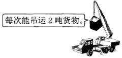

# Mathematics (Grade 4)

**ID**: 1265f815
**难度**: medium
**题型**: fill_in_the_blank

## 题目
码头共有35吨货物，至少要吊运多少次？

## 解答

**答案**: 18次

1. Step1:明确问题是求35吨货物按每次吊运2吨，至少吊运的次数，也就是求35里面有几个2
2. Step2:用除法计算35除以2，得到35÷2＝17（次）……1（吨），即能完整吊运17次还剩余1吨货物
3. Step3:因为剩余1吨货物也需要吊运1次，所以使用进一法，将吊运次数17加上1，得到17＋1＝18（次）

## 知识点

**知识点**:
  - 小学数学;数与代数;数的运算;整数的四则运算;有余数的除法

---
