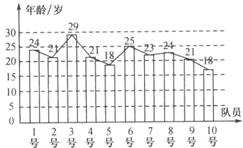

# Mathematics (Grade 4)

**ID**: 3598106a
**难度**: medium
**题型**: fill_in_the_blank

## 题目
图是2003～2004赛季青岛足球队1号～10号队员的年龄统计图，根据统计图可知，这10名队员年龄的中位数是(    )岁，众数是(    )岁．

## 解答

**答案**: 23.5, 21

1. Step1:从统计图中获取10名队员的年龄分别为24、21、29、18、21、25、23、24、21、18
2. Step2:将年龄从小到大进行排序，得到18、18、21、21、21、23、24、24、25、29
3. Step3:计算中位数，因为数据个数为10是偶数，所以中位数是中间两个数的平均值，即(21 + 23)÷2 = 23.5
4. Step4:找出众数，21出现的次数最多，为3次，所以众数是21

## 知识点

**知识点**:
  - 以一当五（或以上）的条形统计图；中位数的意义及求解方法；从统计图表中获取信息．

---
