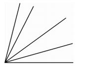

# Mathematics (Grade 4)

**ID**: 46e5982d
**难度**: medium
**题型**: fill_in_the_blank

## 题目
$\textbf{巧数角的个数}$
下图中一共有多少个锐角？

## 解答

**答案**: 10

1. Step1:确定以第一条射线为角的一边的锐角个数为4个
2. Step2:确定以第二条射线为角的一边的锐角个数为3个
3. Step3:确定以第三条射线为角的一边的锐角个数为2个
4. Step4:确定以第四条射线为角的一边的锐角个数为1个
5. Step5:将上述不同情况的锐角个数相加，即4+3+2+1
6. Step6:计算4+3+2+1的结果为10个

## 知识点

**知识点**:
  - 角的认识

---
