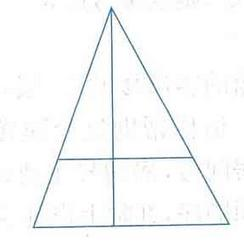

# Mathematics (Grade 4)

**ID**: 49c1feae
**难度**: medium
**题型**: fill_in_the_blank

## 题目
下图中一共有多少个三角形？      

## 解答

**答案**: 6

1. Step1:数出单个的三角形，数量为2个
2. Step2:数出由2个三角形拼出的三角形，数量为1个
3. Step3:数出由一个三角形和一个四边形拼出的三角形，数量为2个
4. Step4:数出最大的三角形，数量为1个
5. Step5:将上述各类三角形的数量相加，2 + 1 + 2 + 1 = 6个

## 知识点

**知识点**:
  - 数学好玩-第二节  数图形的学问
-

---
