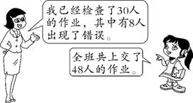

# Mathematics (Grade 4)

**ID**: 4f1bbe6e
**难度**: medium
**题型**: fill_in_the_blank

## 题目
检查作业。

还有多少人的作业没有检查？
算式：________________
口答：还有（_____）人的作业没检查。

## 解答

**答案**: 48-30=18（人）, 18

1. Step1:明确已知条件，全班共上交了48人的作业，已经检查了30人的作业。
2. Step2:分析所求问题是求没检查的作业人数，用全班上交作业总人数减去已检查的人数，即48 - 30。
3. Step3:计算48 - 30的结果为18，所以还有18人的作业没检查。

## 知识点

**知识点**:
  - 小学数学;数与代数;数的运算;整数的四则运算;整数的加法、减法;应用题;简单应用题;整数简单应用题

---
