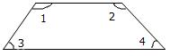

# Mathematics (Grade 4)

**ID**: 51003c77
**难度**: medium
**题型**: fill_in_the_blank

## 题目
量出下图中四个角的度数，并说说你有什么发现。

∠1＝_______   ∠2＝_________ 
∠3＝_______   ∠4＝__________  
我发现:四个角之和是______________ 。

## 解答

**答案**: 125°, 135°, 55°, 45°, 360°

1. Step1:使用量角器测量图中∠1的度数，得到125°
2. Step2:使用量角器测量图中∠2的度数，得到135°
3. Step3:使用量角器测量图中∠3的度数，得到55°
4. Step4:使用量角器测量图中∠4的度数，得到45°
5. Step5:将∠1、∠2、∠3、∠4的度数相加，即125° + 135° + 55° + 45° = 360°，得出四个角之和是360°

## 知识点

**知识点**:
  - 小学数学;图形与几何;平面图形;角;角的度量

---
