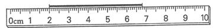

# Mathematics (Grade 4)

**ID**: 5a6f5f95
**难度**: medium
**题型**: fill_in_the_blank

## 题目
下图中的线段长度是________毫米；估一估，大约是________厘米。 

## 解答

**答案**: 48, 5

1. Step1:观察直尺刻度，发现线段起点在2厘米处，即20毫米处
2. Step2:发现线段终点在6厘米8毫米处，即68毫米处
3. Step3:用终点刻度68毫米减去起点刻度20毫米，得到线段长度为68 - 20 = 48毫米
4. Step4:根据四舍五入法，将48毫米估算为50毫米，因为1厘米 = 10毫米，所以50毫米 = 5厘米

## 知识点

**知识点**:
  - 

---
