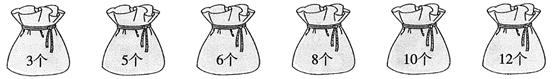

# Mathematics (Grade 4)

**ID**: 64a3fa8a
**难度**: medium
**题型**: fill_in_the_blank

## 题目
数一数，填一填

袋子里装着不同数量的小球。
（1）从左数，第3袋有（_____）个小球；从右数，第（_____）袋有10个小球。
（2）从左数第2个袋子和从右数第3个袋子里一共有（_____）个小球。

## 解答

**答案**: 6, 2, 13

1. Step1:观察图片，从左数，第3袋上标注的小球数量为6个，所以从左数，第3袋有6个小球
2. Step2:观察图片，从右数，第2袋上标注的小球数量为10个，所以从右数，第2袋有10个小球
3. Step3:从左数第2个袋子有5个小球，从右数第3个袋子有8个小球，5 + 8 = 13，所以从左数第2个袋子和从右数第3个袋子里一共有13个小球

## 知识点

**知识点**:
  - 小学数学;数与代数;数的认识;整数的认识;数的运算;整数的四则运算;进位加法

---
