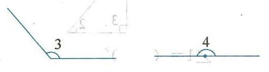

# Mathematics (Grade 4)

**ID**: 79716046
**难度**: medium
**题型**: fill_in_the_blank

## 题目

   ∠3=(    )°是(    )角 ∠4=(    )°是(    )角．

## 解答

**答案**: 120, 钝角, 180, 平角

1. Step1:观察第一个图形，用量角器测量可得∠3 = 120°
2. Step2:因为大于90°小于180°的角是钝角，120°大于90°小于180°，所以∠3是钝角
3. Step3:观察第二个图形，其为一条直线，所以∠4 = 180°
4. Step4:因为等于180°的角是平角，所以∠4是平角

## 知识点

**知识点**:
  - 第八单元  垂线和平行线-第三节  角的分类
-

---
