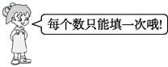

# Mathematics (Grade 4)

**ID**: 82a0ea7a
**难度**: medium
**题型**: fill_in_the_blank

## 题目
把bǎ0、1、2、3、4、6、7、8、9、10填tián在zài下xià面miàn的de□里li,使shǐ每měi道dào加jiā法fǎ算suàn式shì的de得dé数shù都dōu相xiānɡ等děnɡ。
□+□=□+□=□+□=□+□=□+□

## 解答

**答案**: 0, 10, 1, 9, 2, 8, 3, 7, 4, 6

1. Step1:观察所给数字0、1、2、3、4、6、7、8、9、10
2. Step2:尝试将数字两两组合，使每组的和相等
3. Step3:发现0和10相加为10，1和9相加为10，2和8相加为10，3和7相加为10，4和6相加为10
4. Step4:按照等式要求将这些组合依次填入□中，得到0+10=1+9=2+8=3+7=4+6
5. Step5:将等式中的数字按顺序提取出来，即得到['0', '10', '1', '9', '2', '8', '3', '7', '4', '6']

## 知识点

**知识点**:
  - 小学数学;数与代数;数的运算;整数的四则运算;整数的加法、减法

---
