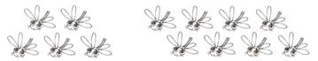

# Mathematics (Grade 4)

**ID**: 82e5719e
**难度**: medium
**题型**: fill_in_the_blank

## 题目
看图列出不同的算式。

□○□=□（只）          □○□=□（只）
□○□=□（只）          □○□=□（只）

## 解答

**答案**: 5+8=13, 8+5=13, 13-5=8, 13-8=5

1. Step1:观察图片，发现左边有5只蜻蜓，右边有8只蜻蜓
2. Step2:根据加法的意义，求一共有多少只蜻蜓，可列出加法算式5+8=13
3. Step3:交换两个加数的位置，可得到另一个加法算式8+5=13
4. Step4:根据总数13只和左边的5只，用减法可求出右边的只数，列出减法算式13-5=8
5. Step5:根据总数13只和右边的8只，用减法可求出左边的只数，列出减法算式13-8=5

## 知识点

**知识点**:
  - 小学数学;数与代数;数的运算;整数的四则运算;进位加法;退位减法

---
