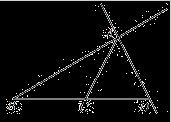

# Mathematics (Grade 4)

**ID**: 9d3bce87
**难度**: medium
**题型**: fill_in_the_blank

## 题目

图中有（  ）条直线，（   ）条射线。

## 解答

**答案**: 1, 6

1. Step1:观察图形，确定直线，可发现有一条直线AD，所以直线数量为1
2. Step2:分别数不同端点的射线数量，以A为端点的射线有3条，以D为端点的射线有2条，以B为端点的射线有1条
3. Step3:将不同端点的射线数量相加，3 + 2 + 1 = 6，得到射线总数为6

## 知识点

**知识点**:
  - 

---
