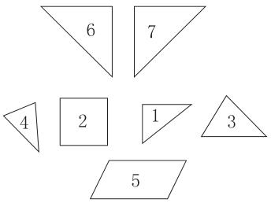

# Mathematics (Grade 4)

**ID**: a981c6e7
**难度**: medium
**题型**: fill_in_the_blank

## 题目
填一填。

(1) 3号图是(    )形，2号图是(   )形，(   )号图是平行四边形。
(2) 图中有(   )个正方形，(   )个三角形和(   )个平行四边形。
(3) 6号图和7号图可以拼成一个(   )形。

## 解答

**答案**: 三角, 正方, 5, 1, 5, 1, 三角

1. Step1:观察3号图的形状，可知3号图是三角形
2. Step2:观察2号图的形状，可知2号图是正方形
3. Step3:观察所有图形，可知5号图是平行四边形
4. Step4:数图中正方形的个数，得出有1个
5. Step5:数图中三角形的个数，得出有5个
6. Step6:数图中平行四边形的个数，得出有1个
7. Step7:观察6号图和7号图，可知它们可以拼成一个三角形

## 知识点

**知识点**:
  - 

---
