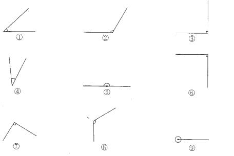

# Mathematics (Grade 4)

**ID**: b9fedc9e
**难度**: medium
**题型**: fill_in_the_blank

## 题目
找一找，分一分．

锐角（_________）直角（_________）钝角（_________）平角（_________）周角（_________）

## 解答

**答案**: ①④, ③⑥⑦, ②⑧, ⑤, ⑨

1. Step1:根据角的分类标准，小于90°的角是锐角，所以锐角为①④
2. Step2:等于90°的角是直角，因此直角是③⑥⑦
3. Step3:大于90°而小于180°的角是钝角，故钝角是②⑧
4. Step4:等于180°的角是平角，所以平角为⑤
5. Step5:等于360°的角是周角，因此周角是⑨

## 知识点

**知识点**:
  - 小学数学;图形与几何;平面图形;角

---
