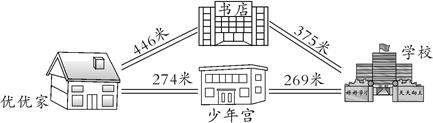

# Mathematics (Grade 4)

**ID**: c5d04c81
**难度**: medium
**题型**: fill_in_the_blank

## 题目
优优从家去学校有（____）条路。他从家经过书店再到学校要走（____）米，他从家经过少年宫再到学校要走（____）米。

## 解答

**答案**: 2, 821, 543

1. Step1:观察路线图可知，优优从家去学校有两条路线，一条是经过书店到学校，一条是经过少年宫到学校，所以第一个空填2
2. Step2:计算从家经过书店再到学校要走的路程，从家到书店是446米，从书店到学校是375米，将两段路程相加，446 + 375 = 821米，所以第二个空填821
3. Step3:计算从家经过少年宫再到学校要走的路程，从家到少年宫是274米，从少年宫到学校是269米，将两段路程相加，274 + 269 = 543米，所以第三个空填543

## 知识点

**知识点**:
  - 小学数学;数与代数;数的运算;整数的四则运算;进位加法

---
