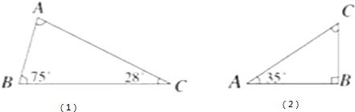

# Mathematics (Grade 4)

**ID**: d4cd587e
**难度**: medium
**题型**: fill_in_the_blank

## 题目
求图中各角的度数．

（1）∠A=(     )，（2）∠C=(     )．

## 解答

**答案**: 77°, 55°

1. Step1:对于第一个三角形，根据三角形内角和是180°，可知求∠A需用180°减去已知的∠B=75°和∠C=28°，即∠A=180° - 75° - 28°
2. Step2:先计算180° - 75° = 105°，再计算105° - 28° = 77°，得出∠A = 77°
3. Step3:对于第二个三角形，因为是直角三角形，直角为90°，根据三角形内角和是180°，求∠C需用180°减去直角90°和已知的∠A=35°，即∠C=180° - 90° - 35°
4. Step4:先计算180° - 90° = 90°，再计算90° - 35° = 55°，得出∠C = 55°

## 知识点

**知识点**:
  - 三角形的内角和

---
