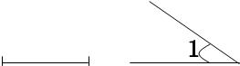

# Mathematics (Grade 4)

**ID**: 011cf9f3
**难度**: medium_hard
**题型**: fill_in_the_blank

## 题目
量一量．
（1）$\underline{\hspace{5em}}$mm
（2）∠1=$\underline{\hspace{5em}}$．

## 解答

**答案**: 26, 35°

1. Step1:使用直尺对给定线段进行测量，得出线段长度为26毫米
2. Step2:依据角的测量方法对∠1进行测量，得出∠1的度数为35°

## 知识点

**知识点**:
  - 角的度量；长度的测量方法．

---
