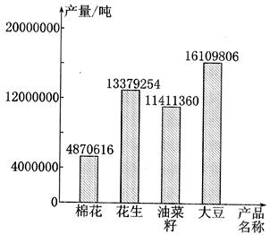

# Mathematics (Grade 4)

**ID**: 051c9655
**难度**: medium_hard
**题型**: fill_in_the_blank

## 题目
下面是某年我国部分农产品产量统计图．

根据统计图完成下面的统计表．（用“万吨”作单位，保留一位小数）
某年我国部分农产品产量统计表
$\begin{array}{|c|c|}
\hline
产品名称
 & 产量/万吨
 \\\hline
棉花
 & （\underline{\hspace{5em}}）
 \\\hline
花生
 & （\underline{\hspace{5em}}）
 \\\hline
油菜籽
 & （\underline{\hspace{5em}}）
 \\\hline
大豆
 & （\underline{\hspace{5em}}）
 \\\hline
\end{array}$

## 解答

**答案**: 487.1, 1337.9, 1141.1, 1611.0

1. Step1:将棉花产量4870616吨换算成以万吨为单位，4870616÷10000 = 487.0616万吨，保留一位小数，根据四舍五入得487.1万吨
2. Step2:将花生产量13379254吨换算成以万吨为单位，13379254÷10000 = 1337.9254万吨，保留一位小数，根据四舍五入得1337.9万吨
3. Step3:将油菜籽产量11411360吨换算成以万吨为单位，11411360÷10000 = 1141.136万吨，保留一位小数，根据四舍五入得1141.1万吨
4. Step4:将大豆产量16109806吨换算成以万吨为单位，16109806÷10000 = 1610.9806万吨，保留一位小数，根据四舍五入得1611.0万吨

## 知识点

**知识点**:
  - 

---
